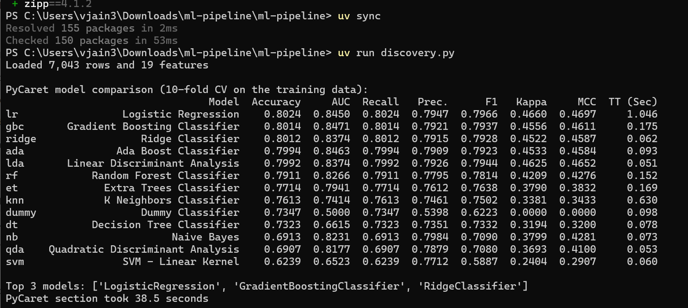
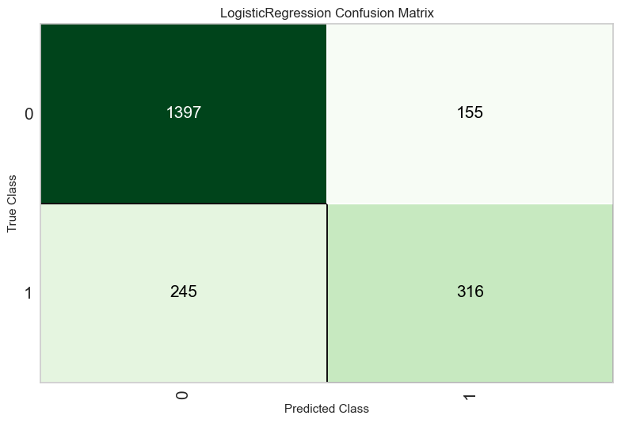
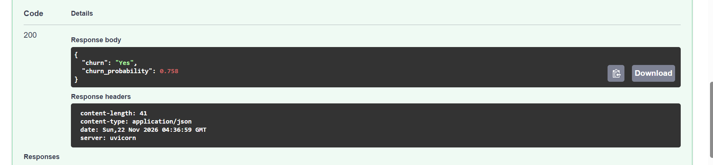

# Telco Customer Churn: PyCaret vs scikit-learn, served with FastAPI

## Business problem

A telecom company loses revenue every time a customer cancels. If we can flag customers who are likely to churn while they're still customers, the retention team can reach out with a discount or a better plan before they leave.

## Dataset

**Telco Customer Churn** (IBM sample data), from Kaggle: https://www.kaggle.com/datasets/blastchar/telco-customer-churn

* 7,043 customers, one row each
* Target: `Churn` (Yes / No). About 27% of customers churned.
* 19 features: account info (`tenure`, `Contract`, `PaymentMethod`, `MonthlyCharges`, `TotalCharges`, ...), services (`InternetService`, `TechSupport`, `StreamingTV`, ...) and demographics (`gender`, `SeniorCitizen`, `Partner`, `Dependents`). Most of them are categorical.

Saved as `data/telco_churn.csv`.

**Dropped columns**

|Column|Why|
|-|-|
|`customerID`|It's just an ID. It's unique to each customer, so it carries no pattern the model can learn and would only add noise.|

I checked every other column for leakage. They all describe the customer's account as it stands today (their contract, services, and what they've paid so far), so all of them are known at prediction time. `TotalCharges` is blank for 11 brand-new customers with 0 months of tenure. I kept the column, converted it to numbers, and let the pipeline impute the blanks.

## How to run

You need [uv](https://docs.astral.sh/uv/). The project is pinned to Python 3.11 because PyCaret doesn't support newer versions.

```bash
git clone <this repo>
cd ml-pipeline
uv sync

# Part 2: run both workflows, save the plots and model.joblib (takes ~2 minutes)
uv run discovery.py

# Part 3: start the API, then open http://127.0.0.1:8000/docs
uv run fastapi dev main.py
```

## Part 2: Comparing the workflows





(In the confusion matrix, 0 = No churn and 1 = Churn. PyCaret label-encodes the target.)

PyCaret's top three were **Logistic Regression**, Gradient Boosting and Ridge Classifier. Logistic Regression is in scikit-learn, so that's what I rebuilt by hand.

**scikit-learn classification report (30% held-out test set)**

```
              precision    recall  f1-score   support

          No     0.8500    0.8982    0.8734      1552
         Yes     0.6660    0.5615    0.6093       561

    accuracy                         0.8088      2113
   macro avg     0.7580    0.7298    0.7414      2113
weighted avg     0.8011    0.8088    0.8033      2113
```

### Comparison

**Efficiency.** The PyCaret section took **38.5 seconds** on my laptop and about 9 lines of code. The scikit-learn section took **0.2 seconds** and about 45 lines. So PyCaret was far cheaper in code I had to write, and scikit-learn was far faster to run. That's not a fair race though: PyCaret trained 14 model types with 10-fold cross-validation (140+ fits), while scikit-learn trained one model once. PyCaret is the better tool for finding the model, and scikit-learn is better for building the one you'll ship.

**Why the scores differ.** PyCaret reported accuracy of 0.8024 and F1 of 0.7966 for Logistic Regression. My classification report shows accuracy of 0.8088 and weighted F1 of 0.8033. PyCaret's numbers are averages across 10 cross-validation folds on the training data, while mine come from one held-out test set, so they won't match exactly. The preprocessing also differs a little (PyCaret uses its own imputation and encoding). One more thing I noticed: PyCaret's Recall column is identical to Accuracy, so it's a weighted average across both classes. The recall that matters here, recall on churners, is only 0.56.

**Which metric matters.** Recall on the "Yes" class. A missed churner is a lost customer and all their future revenue. A false alarm only costs a retention offer to someone who was staying anyway. Right now the model misses 44% of churners, so the next step would be using `class_weight="balanced"` or lowering the decision threshold to catch more of them, at the cost of some precision.

## Part 3: Serving the model

`main.py` loads `model.joblib` once at startup (in FastAPI's `lifespan` function), defines a Pydantic `Customer` class with one field per feature, and exposes `POST /predict`. The categorical fields use `Literal` types, so /docs shows the allowed values and a typo like `"Cable"` gets rejected with a clear error instead of a bad prediction.



**Sample input**

```json
{
  "gender": "Female",
  "SeniorCitizen": 0,
  "Partner": "No",
  "Dependents": "No",
  "tenure": 3,
  "PhoneService": "Yes",
  "MultipleLines": "No",
  "InternetService": "Fiber optic",
  "OnlineSecurity": "No",
  "OnlineBackup": "No",
  "DeviceProtection": "No",
  "TechSupport": "No",
  "StreamingTV": "Yes",
  "StreamingMovies": "Yes",
  "Contract": "Month-to-month",
  "PaperlessBilling": "Yes",
  "PaymentMethod": "Electronic check",
  "MonthlyCharges": 95.5,
  "TotalCharges": 286.5
}
```

**Sample output**

```json
{"churn": "Yes", "churn_probability": 0.758}
```

## Explaining a prediction

I sent the customer above, then changed only one field: `Contract` from `"Month-to-month"` to `"Two year"`.

|Input|Contract|Prediction|Churn probability|
|-|-|-|-|
|1|Month-to-month|Yes|0.758|
|2|Two year|No|0.455|

This makes sense for the business. A customer on a two-year contract would have to pay a cancellation fee to leave, and signing one shows they plan to stay. Month-to-month customers can leave any time. The probability is still fairly high (0.455) because everything else about this customer points to risk: only 3 months in, expensive fiber plan, no tech support or online security, and paying by electronic check. For the retention team, this suggests offering this customer a discount to move to a longer contract.

## AI use

I had Claude write both scripts and the first draft of this README, since most of it is standard pipeline and FastAPI boilerplate. I ran everything myself, took the screenshots, and updated the README with my own run times and scores, which came out slightly different from the draft (F1 0.7966 instead of 0.7965).

One thing I had to check: PyCaret's Recall column matched Accuracy exactly, which meant it was a weighted average across both classes. Recall on actual churners was only 0.56. I also found that typing "Two Year" instead of "Two year" in /docs got rejected with a 422 error, which showed me why the input fields are restricted to exact values. Otherwise the model would quietly give a wrong prediction.
